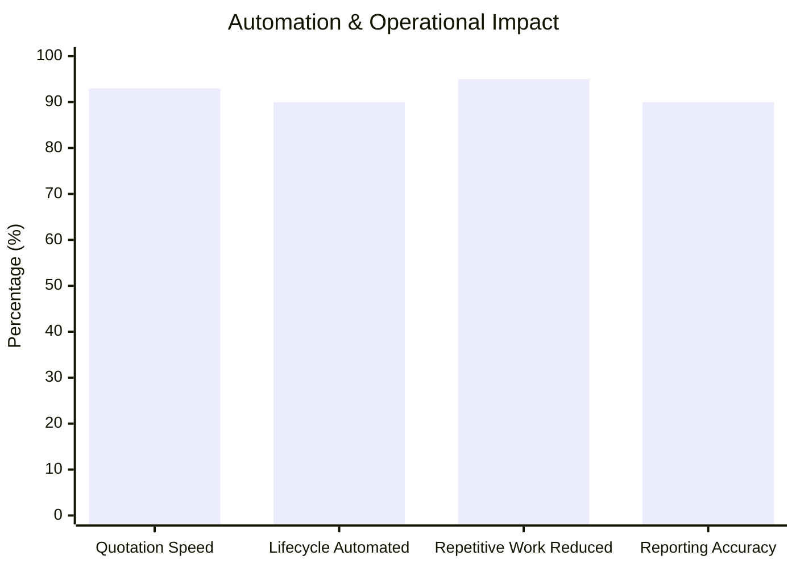
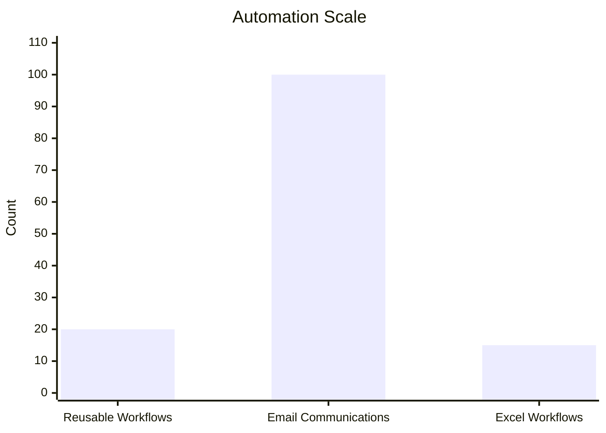

# 👋 Hey, I'm Himanshu Pal

### `AI Automation • ERP Development • Business Analytics`

<p align="center">
  <b>Building intelligent systems that turn business processes into automated workflows.</b>
</p>

<p align="center">
  <a href="https://www.linkedin.com/in/himanshuupal">LinkedIn</a>
  &nbsp; • &nbsp;
  <a href="mailto:himanshuupal2005@gmail.com">Email</a>
</p>

---

## 📊 Developer Dashboard

```text
╭──────────────────────────────────────────────────────────────╮
│                     HIMANSHU PAL                             │
│              AI AUTOMATION • ERP • ANALYTICS                │
├──────────────────────┬───────────────────────────────────────┤
│ 🎓 Education         │ Jagran Lakecity University            │
│ 📍 Focus             │ Business Analytics + Finance          │
│ 🤖 Current Role      │ Harness Trainer — CoverKraft         │
│ ⚙️ Workflows         │ 20+ Reusable Automation Workflows     │
│ 🚀 Quotation Speed   │ 93% Faster                            │
│ 🔄 Lifecycle         │ 90% Automated                         │
│ 📧 Communications    │ 100+ Automated                        │
│ 📊 Reporting         │ 15+ Workflows                         │
│ ⚡ Repetitive Work   │ 95% Reduction                         │
└──────────────────────┴───────────────────────────────────────┘
```

---

# 🧑‍💻 About Me

I'm a **Business Analytics student and technology builder** focused on the intersection of:

```text
             BUSINESS
                │
                ▼
          PROCESS DESIGN
                │
        ┌───────┴───────┐
        ▼               ▼
       DATA            AI
        │               │
        └───────┬───────┘
                ▼
           AUTOMATION
                │
                ▼
          BUSINESS IMPACT
```

My work focuses on **AI workflow automation, ERP development, business process automation, AI agents, API integration, and data-driven decision making**.

---

# 📈 My Growth Journey

```text
2024
 │
 │  🎓 Started BMS
 │  Business Analytics + Finance
 ▼
2025
 │
 │  📊 Business Intelligence
 │  📈 Power BI / Analytics
 │  ⚙️ ERP Development
 ▼
2026
 │
 │  🏢 Meal Service ERP
 │  🤖 Enterprise AI Harness
 │  ⚡ Workflow Automation
 ▼
NOW
 │
 └──────────────► AI + Automation + ERP
```

### Career Timeline

| Period       | Milestone                | Focus                              |
| ------------ | ------------------------ | ---------------------------------- |
| **Aug 2024** | 🎓 BMS begins            | Business Analytics + Finance       |
| **Apr 2025** | 📊 JP Morgan Simulation  | Quantitative Research              |
| **Jun 2025** | 📈 Infosys Certification | Business Intelligence              |
| **Oct 2025** | 🏢 ECH Business Solution | ERP / Full Stack Development       |
| **Feb 2026** | 🍱 Meal Service ERP      | ERP + Automation                   |
| **Jun 2026** | 🤖 CoverKraft            | AI Harness + Automation            |
| **Present**  | ⚡ Enterprise Automation  | AI Agents + Workflow Orchestration |

## The timeline reflects the dates and roles documented in the resume.

# 🚀 Growth Through Impact

Instead of showing artificial "skill percentages", these charts show **real outcomes from projects and professional work**.

## ⚡ Automation Impact



### What these numbers mean

**93%**
Faster quotation turnaround — from approximately **15 minutes to under 1 minute**.

**90%**
Motor Insurance operational lifecycle automated.

**95%**
Reduction in repetitive operational effort.

**90%**
Improvement in reporting accuracy.

These are the quantified results stated in the CoverKraft experience section of the resume.

---

# 📊 Automation Scale



### Current Automation Footprint

| Metric                            |    Scale |
| --------------------------------- | -------: |
| 🔄 Reusable automation workflows  |  **20+** |
| 📧 Automated email communications | **100+** |
| 📊 Automated Excel workflows      |  **15+** |

The resume specifically reports 20+ reusable workflows, 100+ automated email communications, and 15+ Excel reporting workflows.

---

# 🧠 Technology Evolution

My development journey has progressively moved from **analytics → systems → automation → AI orchestration**.

```text
2024
Business Analytics
      │
      ▼
2025
BI + Data Tools
      │
      ▼
ERP Development
      │
      ▼
2026
Business Automation
      │
      ▼
AI Workflow Automation
      │
      ▼
AI Harness + Agents
```

### Current Technology Areas

```text
┌─────────────────────────────────────────────────────────┐
│                    TECH STACK                            │
├─────────────────────────────────────────────────────────┤
│                                                         │
│  🐍 Python                                               │
│  ⚙️ Workflow & Business Process Automation              │
│  🤖 Generative AI / AI Agents                            │
│  🏢 ERP Development                                      │
│  🔌 API Integration                                      │
│                                                         │
│  📊 Power BI                                             │
│  📗 Advanced Excel / Power Query                        │
│  📈 Google Looker Studio                                │
│  📋 Google Sheets                                       │
│                                                         │
│  🔄 n8n                                                  │
│  🧠 Claude / Antigravity / OpenClaw / NanoClaw / Hermes │
│  🗄️ Supabase / PostgreSQL                               │
│  🐳 Docker / WSL / Git                                  │
│  🔗 MCP                                                  │
│                                                         │
└─────────────────────────────────────────────────────────┘
```

These technologies are based on the skills and platforms listed in the resume.

---

# 🤖 Current Focus — AI Harness

## CoverKraft

**Harness Trainer | June 2026 — Present**

Currently working on enterprise AI automation using reusable workflows and multi-agent orchestration.

```text
                    CUSTOMER
                       │
                       ▼
                 DOCUMENT DATA
                       │
                       ▼
               AI WORKFLOW ENGINE
                       │
          ┌────────────┼────────────┐
          ▼            ▼            ▼
      QUOTATION      KYC        COMMUNICATION
          │            │            │
          └────────────┼────────────┘
                       ▼
                POLICY PROCESSING
                       │
                       ▼
                  REPORTING
```

### Impact Snapshot

```text
┌─────────────────────┬─────────────────┐
│ Metric              │ Result          │
├─────────────────────┼─────────────────┤
│ Quotation Speed     │ 93% Faster      │
│ Lifecycle Automation│ 90%             │
│ Workflows           │ 20+             │
│ Emails Automated    │ 100+            │
│ Excel Workflows     │ 15+             │
│ Repetitive Effort   │ 95% Reduced    │
│ Reporting Accuracy  │ 90% Improved    │
└─────────────────────┴─────────────────┘
```

---

# 🏢 ERP Development

## ECH Business Solution

**Full Stack Developer | October 2025 — June 2026**

Designed and developed a custom **ERP Inventory Module** using:

`Google Apps Script` · `HTML` · `JavaScript` · `Google Sheets`

The system centralized inventory across vendors, warehouses, sites and employees while maintaining movement traceability.

```text
VENDORS
   │
   ▼
WAREHOUSE
   │
   ├──────────────► SITES
   │
   ├──────────────► EMPLOYEES
   │
   ▼
INVENTORY
   │
   ▼
MOVEMENT TRACEABILITY
   │
   ▼
ANALYTICS + AUTOMATION
```

---

# 🍱 Featured Project

## Meal Service ERP System

**February 2026 — April 2026**

A centralized ERP system designed to manage meal-service operations from customer onboarding through delivery.

```text
CUSTOMER
    │
    ▼
SUBSCRIPTION
    │
    ├──────► PAYMENT
    │
    ├──────► ORDER
    │
    └──────► DELIVERY
                │
                ▼
          ERP DASHBOARD
```

### Core Areas

* 👤 Customer lifecycle
* 🔄 Subscription management
* 💳 Payment management
* 🚚 Delivery tracking
* ⚙️ Workflow automation
* 📊 Real-time dashboards
* 📈 Pricing analysis
* 🤝 CRM & after-sales support

---

# 📊 Business Analytics

My analytics background connects operational data with business decisions.

```text
RAW DATA
   │
   ▼
DATA CLEANING
   │
   ▼
DATA MODEL
   │
   ▼
ANALYSIS
   │
   ▼
DASHBOARD
   │
   ▼
BUSINESS DECISION
```

### Tools

`Advanced Excel` · `Power Query` · `Power BI` · `Google Looker Studio` · `Google Sheets`

---

# 🏆 Achievements & Certifications

## Certifications

| Certification                         | Organization           | Date     |
| ------------------------------------- | ---------------------- | -------- |
| Data Analytics                        | Deloitte               | Jan 2026 |
| Power BI for Beginners                | Simplilearn            | Oct 2025 |
| From Excel to Power BI                | Knowledge Accelerators | Nov 2025 |
| Introduction to Business Intelligence | Infosys Springboard    | Jun 2025 |
| Quantitative Research Job Simulation  | JP Morgan Chase & Co.  | Apr 2025 |

---

# 🔥 What I'm Building Toward

```text
                BUSINESS
                   │
                   ▼
            ┌──────────────┐
            │   DATA       │
            └──────┬───────┘
                   │
                   ▼
            ┌──────────────┐
            │   AI         │
            └──────┬───────┘
                   │
                   ▼
          ┌─────────────────┐
          │   AUTOMATION    │
          └────────┬────────┘
                   │
                   ▼
          ┌─────────────────┐
          │  ERP / SYSTEM   │
          └────────┬────────┘
                   │
                   ▼
             REAL IMPACT
```

> **My goal is to build systems where data, AI and automation work together to solve real business problems.**

---

# 🌐 Let's Connect

<p align="center">

<a href="https://www.linkedin.com/in/himanshuupal">

</a>

<a href="mailto:himanshuupal2005@gmail.com">

</a>

</p>

---

<div align="center">

### `BUILD • AUTOMATE • ANALYZE • IMPROVE`

**Turning business problems into technology-driven solutions.**

</div>
