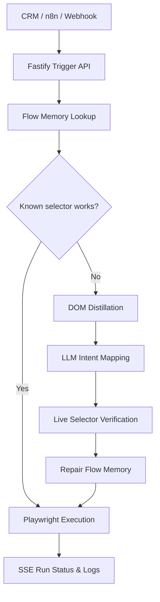

<!--
  Himanshu Pal — GitHub profile dashboard
  Resume-aligned refresh: 10 November 2026
  Live widgets use public GitHub data; resume impact metrics are labelled separately.
-->

# Himanshu Pal

### AI Automation · Business Analytics · ERP Engineering

**Building intelligent systems that turn business processes into measurable outcomes.**

<a href="https://himanshuupal-portfolio.vercel.app">Portfolio</a> ·
<a href="https://www.linkedin.com/in/himanshuupal">LinkedIn</a> ·
<a href="mailto:himanshuupal2005@gmail.com">Email</a>

---

## Professional snapshot

I'm a **Business Management Studies undergraduate specialising in Business Analytics and Finance** at Jagran Lakecity University. I work at the intersection of AI application development, workflow automation, data analytics and business systems.

My recent work includes LLM-based applications, Retrieval-Augmented Generation (RAG), multi-agent orchestration, API integrations, transaction-oriented ERP data models and analytics dashboards.

<table>
<tr>
<td width="50%" valign="top">

### What I build

- LLM applications and RAG workflows
- AI agents and reusable automation
- API-connected business processes
- Inventory and service ERP systems
- Data pipelines, analysis and BI dashboards

</td>
<td width="50%" valign="top">

### Core toolkit

- **Code:** Python, SQL, JavaScript, HTML
- **AI:** LLMs, RAG, MCP, prompt engineering
- **Data:** Power BI, Power Query, Advanced Excel
- **Platforms:** PostgreSQL, Supabase, n8n
- **Engineering:** Git, GitHub, Docker, WSL

</td>
</tr>
</table>

---

## Selected impact

These figures are outcomes reported in my resume for my **June–August 2026 AI Trainer Internship at Agribook Tech Solutions & Allied Services**. They describe professional work, not GitHub activity statistics.

<table>
<tr>
<td align="center" width="25%">
<h2>20+</h2>
Reusable AI automation workflows
</td>
<td align="center" width="25%">
<h2>93%</h2>
Faster quotation turnaround
</td>
<td align="center" width="25%">
<h2>90%</h2>
Motor insurance lifecycle automated
</td>
<td align="center" width="25%">
<h2>100+</h2>
Email communications automated
</td>
</tr>
</table>

**Quotation turnaround:** approximately 15 minutes to under 1 minute. The resume also reports automation of 15+ Excel reporting workflows and a 90% improvement in reporting accuracy.

---

## Featured engineering work

### 1. Self-Healing Automation Harness

**AI-assisted web automation · Insurance operations · Multi-tenant / multi-LOB design**

A web automation engine built around deterministic flow-memory replay, with LLM-based repair when page selectors no longer resolve. The repository documents a Fastify API, Playwright engine, SSE live logs, tenant-specific JSON storage and local/cloud LLM failover.

**Architecture at a glance**

Repository: [himanshupal2005/harness](https://github.com/himanshupal2005/harness)

### 2. Inventory ERP Module — ECH Business Solution

**Full Stack Developer Intern · October 2025 – July 2026**

Designed and developed an inventory module using Google Apps Script, HTML, JavaScript and Google Sheets. It centralises stock movement across vendors, warehouses, sites and employees, with traceability and transaction-oriented data modelling.

### 3. Meal Service ERP System

**February 2026 – April 2026**

A centralised meal-service operations platform covering customer lifecycle, subscriptions, payments and delivery tracking. The project also applied exploratory analysis to order patterns and customer behaviour, with dashboards to support pricing and retention decisions.

### 4. Touchless Cursor

**Computer vision prototype · Hands-free desktop interaction**

A webcam-based prototype using hand landmarks and gesture recognition to map movements to cursor actions.

Stack listed in the portfolio: `Python` · `MediaPipe` · `OpenCV` · `PyAutoGUI`

Repository: [Touchless_Cursor](https://github.com/himanshupal2005/Touchless_Cursor)

### 5. Data Analytics & BI Projects

Hands-on project work includes:

- [Superstore data cleaning](https://github.com/himanshupal2005/Elevate_labs_01) — Excel and Power Query.
- [Superstore dashboard insights](https://github.com/himanshupal2005/Elevate_labs_02) — category, regional and discount profitability.
- [SQL analysis](https://github.com/himanshupal2005/Elevate_labs_03) — joins, aggregations, customer analysis and AOV.
- [SQL business insights](https://github.com/himanshupal2005/Elevate_labs_04) — filtering, subqueries and segmentation.
- [Python data cleaning](https://github.com/himanshupal2005/Elevate_labs_05) and [data quality analysis](https://github.com/himanshupal2005/Elevate_labs_06).
- [Used-car market analysis](https://github.com/himanshupal2005/Elevate_labs_07) — pricing, ownership, fuel and depreciation.
- [Job trend analysis](https://github.com/himanshupal2005/Linkedin_job_trend_analysis_project_internship) — job-posting collection and skill-demand analysis.

---

## Technology map

| Area | Tools and methods |
|---|---|
| Programming & automation | Python, SQL, JavaScript, HTML, Google Apps Script, API integration |
| AI & orchestration | LLMs, RAG, AI agents, prompt engineering, MCP, n8n, Claude, Antigravity, OpenClaw, NanoClaw, Hermes |
| Analytics & BI | EDA, data cleaning, statistics, Advanced Excel, Power BI, Power Query, Looker Studio, Google Sheets |
| Data & development | PostgreSQL, Supabase, Git, GitHub, Docker, WSL, ERP development |

---

## GitHub activity

Displays the total contribution count only. This is separate from the professional impact figures above.

---

## Experience & education

| Period | Experience |
|---|---|
| **Jun 2026 – Aug 2026** | **AI Trainer Intern**, Agribook Tech Solutions & Allied Services — AI harness, multi-agent workflows, insurance operations and reporting automation |
| **Oct 2025 – Jul 2026** | **Full Stack Developer Intern**, ECH Business Solution — inventory ERP, Google Apps Script, HTML, JavaScript and Google Sheets |
| **Aug 2024 – Present** | **Bachelor of Management Studies**, Jagran Lakecity University — Business Analytics and Finance |

## Certifications

- Data Analytics — Deloitte (January 2026)
- From Excel to Power BI — Knowledge Accelerators (November 2025)
- Power BI for Beginners — Simplilearn (October 2025)
- Introduction to Business Intelligence — Infosys Springboard (June 2025)
- Quantitative Research Job Simulation — JPMorgan Chase & Co. (April 2025)

---

## Additional portfolio highlights

The following achievements are listed in the portfolio source and are included here as supplementary portfolio context (separate from the latest resume's certifications section).

| Year | Recognition | Event / Institution |
|---|---|---|
| 2026 | Runner-Up — Crack the Case | Criminal Case Investigation · Jagran Lakecity University |
| 2025 | 1st Place — Lights, Camera & Ads | Sagar Exuberance 4.0 · SISTec |
| 2025 | Winner — Ideathon | Global Entrepreneurship Week · CII |
| 2025 | Certificate of Distinction | TERI Green Olympiad for Youth · 96% score |
| 2025 | Chancellor's Scholarship Award | Jagran Lakecity University |
| 2024 | Outstanding Talent | Deltron Technologies Pvt. Ltd. |

---

### BUILD · AUTOMATE · ANALYZE · IMPROVE

**Turning business problems into technology-driven solutions.**

[Portfolio](https://himanshuupal-portfolio.vercel.app) ·
[LinkedIn](https://www.linkedin.com/in/himanshuupal) ·
[GitHub](https://github.com/himanshupal2005)

